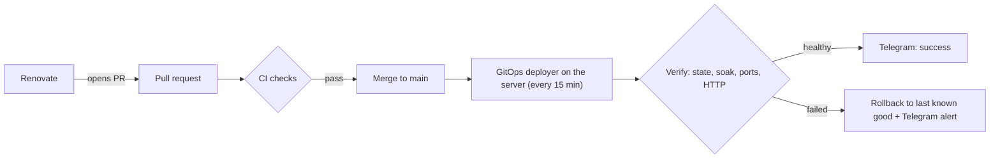

[](https://github.com/gravi-ctrl/homelab-blueprint/actions/workflows/lint.yml)
[](https://github.com/gravi-ctrl/homelab-blueprint/actions/workflows/terraform.yml)
[](https://github.com/gravi-ctrl/ctrl-s-master/actions/workflows/ci.yml)
[](https://github.com/gravi-ctrl/server-docker-backup/actions/workflows/security.yml)
[](https://github.com/gravi-ctrl/server-docker-backup/actions/workflows/ci.yml)

# 🛠️ Homelab Blueprint

This is the automation engine behind my home server. It issues its own certificates, deploys its own updates, checks that they worked, rolls back when they didn't, and tells me about it on Telegram. If the machine dies, I can rebuild it from a backup in about 25 minutes.

**Location on Server:** `~/scripts`

🖥️ **Live Interactive Dashboard:**
* [gravi-ctrl.github.io/homelab-blueprint](https://gravi-ctrl.github.io/homelab-blueprint/)

### ✨ The Short Version

* **Rebuilds in about 25 minutes.** I tested a full restore on a wiped VM: ~15 minutes for the OS, ~10 for the stacks.
* **Self-checking deploys.** Merge a PR and the server picks it up within 15 minutes, updates only what changed, verifies it, and rolls back on failure (see `gitops-deploy.sh`).
* **Nothing ships unchecked.** Every change goes through linting, tests, security scans and a Terraform plan before it can reach `main`.
* **No silent failures.** Every scheduled job reports to Telegram, and repeated errors are grouped so my phone doesn't get spammed.
* **Encrypted weekly backups**, plus a daily snapshot of scripts, crontabs and package lists.
* **Self-documenting.** Scripts describe themselves, and a live dashboard is built from that.
* **GitHub settings as code.** Repo rules and settings live in Terraform, with the state stored remotely.

---

## ⚙️ How it Works

**Certificates.** The server runs its own certificate authority, issues its own SSL certs, and hands them to the reverse proxy without me doing anything (see `cert-manager`).

**Alerts.** Every scheduled job runs through a small wrapper I wrote, `cron-guard.py`, so I get a Telegram message for almost everything. If a job crashes and spits out a huge log, I get a short summary on my phone and the full output is saved on the server.

**Backups.** The server takes a snapshot of itself every day: scripts, crontabs, package lists and so on. Once a week it makes an encrypted archive (with `age`) of the whole stack and checks that it's good. I tested a full restore on a VM, and a wiped machine was back online in **25 minutes**: about 15 for the OS install and about 10 for the stack restore (see the runbook below).

**Docs that write themselves.** After I write or change a script, I run `doc-injector.py`. It asks an LLM what the script does and writes the answer into the script's header. At 5 AM the live dashboard picks those headers up, so the docs stay in sync with the code.

**`oracle`.** My terminal AI helper (Jarvis was overused, so `oracle` it is). I can pipe Docker logs, systemd traces or a whole script into it and get a root-cause analysis streamed back. Secrets are scrubbed from the text before anything leaves the server.

The result: the server mostly runs itself, and when something does go wrong, I usually hear about it before I'd have noticed.

> To see why the fixed paths, ownership rules and script dependencies are set up the way they are, read [`ARCHITECTURE.md`](./ARCHITECTURE.md).

---

## 🧪 CI/CD & Automated Quality Gates

Every commit and pull request across my repos gets checked before any code or container config can reach the server:

* **Linting:** [ShellCheck](https://www.shellcheck.net/) for Bash, [Ruff](https://docs.astral.sh/ruff/) for Python, and [Hadolint](https://github.com/hadolint/hadolint) for Dockerfiles.
* **Stack validation:** A custom CI job goes through every Docker Compose stack and runs `docker compose config -q` against its `.env.example`, so syntax and schema mistakes show up before deployment. (The `.env.example` is there because the real `.env` files are not in git.)
* **Automated tests:** `pytest` runs on the core utility modules, on both `ubuntu-latest` and `windows-latest`.
* **Security and supply chain:**
  * [Trivy](https://github.com/aquasecurity/trivy) scans for committed credentials, API keys and Dockerfile misconfigurations (`HIGH` and `CRITICAL`).
  * A weekly scan checks the published image (`ghcr.io/gravi-ctrl/wifi-robot:latest`) for newly reported vulnerabilities.
* **Container images:** Merging a change to `wifi-robot/` builds the image and pushes it to GitHub Container Registry (`ghcr.io`). The weekly scan above keeps watching it.
* **Infrastructure as Code (Terraform):** The settings of my three GitHub repos (`homelab-blueprint`, `ctrl-s-master`, `server-docker-backup`) are managed with Terraform modules, and the state is stored in Backblaze B2 (S3-compatible). When I open a PR, a bot runs `terraform plan` and posts the result as a comment. When I merge to `main`, `terraform apply` runs automatically.
* **GitOps deployment:** Merging a PR (usually a Renovate dependency update) is the whole release process. The server pulls `main` every 15 minutes with `gitops-deploy.sh` and redeploys only the stacks that changed and are already running, one at a time. Each one is checked after the update: container state, a crash-loop watch, and port and HTTP checks compared to what was healthy *before*. If a stack fails, it's rolled back to its last known good compose file and I get a Telegram alert.

---

## 💡 How This Was Built

* **Design & Logic:** The workflows, recovery plans, and architecture are all mine. I broke things, figured out why, and fixed them, and this repo is what's left after all of that.
* **Code & AI Pairing:** I wrote the main Bash automations by hand. I used AI to speed up the rest, mostly the Python scripts, and to clean up syntax and catch edge cases I missed.
* **Sanity Checks:** Every change goes through GitHub Actions (ShellCheck, Ruff, Trivy, and Terraform format/validate) before it gets anywhere near production.

---

## 🔁 How a Change Reaches the Server



`main` is protected in every repo (a PR and passing checks are required), and no script ever pushes to it. Anything the server generates goes to its own side branch: dashboards to `pages`, system snapshots to `snapshots`. If something on the server changes without going through a PR, it shows up in a daily drift report instead of being committed quietly. The reasoning is in [`ARCHITECTURE.md`](./ARCHITECTURE.md) §16–19.

---

## 🚨 Deployment & Recovery

```mermaid
graph TD
    %% Main Path
    A[Encrypted Backup + Key] --> B[Phase 1: bootstrap.sh]
    B --> C[Phase 2: setup.sh]
    
    %% The Spawning of the Ghost
    C -- spawns --> GW[<i>Ghost Watcher Daemon</i>]
    
    C --> D[<b>Phase 3: Manual Reboot</b>]
    D --> E[Spin up Docker Stacks]
    E --> F((<b>Server Online</b>))

    %% The Background Path
    GW -.->|Monitoring| E
    E -.->|Watched containers online| G[Run Post-Start Tasks]
    G -.->|Notify via Telegram| H[<b>Self Destruct</b>]

    %% Styling
    style GW fill:#1f242b,stroke:#8b5cf6,stroke-dasharray: 5 5
    style H fill:#1f242b,stroke:#ef4444
    style F fill:#1f242b,stroke:#3fb950
    style B fill:#1f242b,stroke:#3081f7
    style C fill:#1f242b,stroke:#3081f7
```



There are two ways to rebuild the server: a **Full Recovery** (restore the weekly `docker-stacks-DATE.tar.zst.age` archive) or a **Fresh Start** (build everything from scratch).

The full backup archive has everything needed to bring back the exact state:

| Path | What | Restoration Note |
|------|------|------------------|
| `~/scripts` | This repository (Automation Engine) | Cloned from Git |
| `/opt/stacks` | Docker Stacks `[Private Infrastructure]` (Compose files & `.env.example`) | Cloned from Git; permissions restored via `.git-perms` |
| `~/ctrl_s_master` | [Credential Archival Engine](https://github.com/gravi-ctrl/ctrl-s-master) | Cloned from Git |
| `~/.ssh` | Deploy keys & authorized_keys | Restored via tarball (Full) or pre-flight checklist (Fresh) |
| `/etc/ssh` | Host keys & custom daemon configs | Restored via tarball (Full) or `setup.sh` drop-in (Fresh) |
| `~/.local/share/mkcert` | Local CA for SSL | Restored via tarball (Full) or recreated on Fresh |

---
<p align="center"><b>[ RUNBOOK ]</b></p>

---

### Phase 1 — Bootstrap

The bootstrap script is designed to handle both a **Full Recovery** (decrypts archive) and a **Fresh Start** (skips decryption, dynamically fetches repos).

**1. Preparation:**
Choose your scenario before running the script:

*   **Option A: Full Recovery**
    Ensure `docker-stacks-*.tar.zst.age` is in `$HOME`. Retrieve your age decryption key and paste it:
    ```bash
    sudo nano /root/.backup-key.txt
    sudo chmod 600 /root/.backup-key.txt
    ```
*   **Option B: Fresh Start (No Backup)**
    Before executing the script, prepare `~/.ssh/` with:
    1. `authorized_keys`: Your laptop/workstation's **public key** (prevents lockout when password auth is disabled).
    2. Git Deploy Private Key: Key(s) authorized on GitHub.
    3. `config` *(optional)*: Host mapping if using custom key names.

**2. Download, Verify, and Run Bootstrap:**

For maximum security, verify the script's cryptographic hash before executing it on a live server.

1. **Download the script:**
   ```bash
   curl -fsSL github.com/gravi-ctrl/homelab-blueprint/raw/main/run_once/bootstrap.sh -o "$HOME/bootstrap.sh"
   ```

2. **Retrieve the trusted hash:**
   Grab the SHA-256 hash of `bootstrap.sh` stored in your password manager.

3. **Verify and execute:**
   Replace `<hash>` below with your stored hash. If the checksum matches, the script runs immediately:
   ```bash
   echo "<hash>  $HOME/bootstrap.sh" | sha256sum --check - && bash "$HOME/bootstrap.sh"
   ```

> [!NOTE]
> This script bootstraps your server by handling system configuration, SSH setup, and Git repository cloning. It offers two paths:
> - **Full Recovery:** Decrypts and restores from an existing backup archive.
> - **Fresh Start:** Initializes clean repositories (requires your SSH private keys to be in `~/.ssh` before starting).

<details>
<summary><b>Fresh Start Only: Initialize .env files</b></summary>

> Since you skipped the backup, your configurations are missing. Fill in your secrets:
> ```bash
> find ~/scripts -type f -name ".env.example" -execdir cp --update=none .env.example .env \;
> ```
</details>

---

### Phase 2 — System Provisioning

Run the main installer:
```bash
~/scripts/run_once/setup.sh
```
*This installs Docker, firewall, directory structure, Python libraries, Unbound DNS, ZSH, and restores your system configs (crontabs, hosts, etc).*

At the end, it spawns the **Ghost Watcher** (`container-watcher.sh`), a background service that waits for containers to come online and runs their post-start configuration tasks.

> [!NOTE]
> **The Ghost Watcher Engine:**
> The watcher is fully modular and controlled via `WATCHER_TASKS` in `/opt/rabbit-hole/.env`. Once all tasks complete, the daemon deletes its state file and self-destructs.

---

### Phase 3 — Docker & Finalize

**1. Reboot the Server (Recommended):**
A quick reboot applies group permissions (`docker`), shell changes (`zsh`), and confirms all systemd services persist cleanly across boots.
```bash
sudo reboot
```

<details>
<summary><b>Fresh Start Only: Initialize Stack Secrets</b></summary>

> Since you started fresh, `/opt/stacks` lacks its `.env` files. 
> Generate the templates first:
> ```bash
> for d in /opt/stacks/*/; do [ -f "${d}.env.example" ] && cp --update=none "${d}.env.example" "${d}.env"; done
> ```
> Fill in what you can from your password manager. Some secrets (e.g. OIDC client credentials) can only be obtained after spinning up their respective services first.

</details>

**2. Restore the Stacks:**
Move to `/opt/stacks` and spin up your infrastructure.

```bash
# Start Dockge to manage stacks via UI
# (Recommended for Fresh Starts: edits to stack .env files can be done directly in the web UI)
cd /opt/stacks/dockge && docker compose up -d
```
Or
```bash
# Bring up everything at once
find /opt/stacks -maxdepth 2 -name "compose.yml" -execdir docker compose up -d \;
```

> [!TIP]
> **The Ghost Watcher in Action:** As soon as you run `docker compose up -d`, the Ghost Watcher detects containers coming online, executes their internal readiness checks, runs their post-start scripts, sends a Telegram confirmation, and silently uninstalls itself from systemd.

---

<div align="center">

[](https://github.com/gravi-ctrl)

<br>

<sub>Part of the **gravi-ctrl** homelab ecosystem • Built for reproducibility and repeatable recovery</sub>

</div>
