[](https://github.com/gravi-ctrl/homelab-blueprint/actions/workflows/yml.yml)
[](https://github.com/gravi-ctrl/ctrl-s-master/actions/workflows/ci.yml)
[](https://github.com/gravi-ctrl/server-docker-backup/actions/workflows/security.yml)
[](https://github.com/gravi-ctrl/server-docker-backup/actions/workflows/ci.yml)

# 🛠️ Homelab Blueprint

This repository functions as the automation engine for my home server. It acts as a self-documenting "Source of Truth" handling everything from SSL/Proxy provisioning to high-resilience backups and real-time Telegram observability.

**Location on Server:** `~/scripts`

🖥️ **Live Interactive Dashboard:** 
* [gravi-ctrl.github.io/homelab-blueprint](https://gravi-ctrl.github.io/homelab-blueprint/)

---

## ⚙️ How it Works

The server manages its own SSL certificates, issues them via a local CA, and deploys them to the reverse proxy automatically. Scheduled tasks run through a custom Telegram wrapper, so failures are never silent. If a job crashes and dumps a massive log, the wrapper sends a summary to your phone and saves the full output locally. 

The server snapshots its own state daily: scripts, crontabs, package lists, etc. Scripts automatically document their own operational capabilities into their headers via an automated analyzer (doc-injector.py), keeping the live web dashboard in sync with code logic. Once a week, a verified age-encrypted archive captures the entire stack, ready to restore a wiped machine in under an hour.

For on-demand triage, an integrated terminal assistant (oracle) allows piping live Docker logs, systemd traces, or full scripts for instant, stream-rendered root-cause analysis with automated secret scrubbing.

The result: the server largely runs itself, and when something does go wrong, you already know about it before you notice.

> For the design reasoning behind the fixed paths, ownership rules, and cross-script dependencies, see [`ARCHITECTURE.md`](./ARCHITECTURE.md).

---

## 🧪 CI/CD & Automated Quality Gates

Every commit and Pull Request across the ecosystem is validated before code or container configurations touch the server:

* **Static Analysis & Linting:** Automated workflows run [ShellCheck](https://www.shellcheck.net/) across all Bash scripts, [Ruff](https://docs.astral.sh/ruff/) on Python automation tools, and [Hadolint](https://github.com/hadolint/hadolint) on Dockerfiles.
* **Stack Validation:** A custom CI runner automatically iterates through all Docker Compose stacks, instantiates mock environments from `.env.example`, and runs `docker compose config -q` to catch syntax or schema errors before deployment.
* **Automated Testing:** Cross-platform matrix testing (`ubuntu-latest` & `windows-latest`) executes `pytest` suites on core utility modules.
* **Supply-Chain & Security Scanning:** 
  * [Trivy](https://github.com/aquasecurity/trivy) scans for committed credentials, API keys, and Dockerfile misconfigurations (`HIGH`, `CRITICAL`).
  * Weekly scheduled CVE scans monitor published images (`ghcr.io/gravi-ctrl/wifi-robot:latest`) for newly reported upstream vulnerabilities.
* **GitOps Continuous Deployment:** Merging a container update triggers an automated build and push to GitHub Container Registry (`ghcr.io`), which the server's local GitOps engine (`gitops-deploy.sh`) pulls, validates, and deploys with sequential zero-downtime restarts.

---

## 🚨 Deployment & Recovery

```mermaid
graph TD
    %% Main Path
    A[Encrypted Backup + Key] --> B[Phase 1: bootstrap.sh]
    B --> C[Phase 2: setup.sh]
    
    %% The Spawning of the Ghost
    C -- spawns --> GW[<i>Ghost Watcher Daemon</i>]
    
    C --> D[<b>Phase 3: Manual Reboot</b>]
    D --> E[Spin up Docker Stacks]
    E --> F((<b>Server Online</b>))

    %% The Background Path
    GW -.->|Monitoring| E
    E -.->|Watched containers online| G[Run Post-Start Tasks]
    G -.->|Notify via Telegram| H[<b>Self Destruct</b>]

    %% Styling
    style GW fill:#1f242b,stroke:#8b5cf6,stroke-dasharray: 5 5
    style H fill:#1f242b,stroke:#ef4444
    style F fill:#1f242b,stroke:#3fb950
    style B fill:#1f242b,stroke:#3081f7
    style C fill:#1f242b,stroke:#3081f7
```



The server can be provisioned in two ways: **Full Recovery** (restoring a weekly `docker-stacks-DATE.tar.zst.age` archive) or a **Fresh Start** (bootstrapping from scratch). 

A full backup archive contains everything needed to restore the exact state:

| Path | What | Restoration Note |
|------|------|------------------|
| `~/scripts` | This repository (Automation Engine) | Cloned from Git |
| `/opt/stacks` | Docker Stacks `[Private Infrastructure]` (Compose files & `.env.example`) | Cloned from Git; permissions restored via `.git-perms` |
| `~/ctrl_s_master` | [Credential Archival Engine](https://github.com/gravi-ctrl/ctrl-s-master) | Cloned from Git |
| `~/.ssh` | Deploy keys & authorized_keys | Restored via tarball (Full) or pre-flight checklist (Fresh) |
| `/etc/ssh` | Host keys & custom daemon configs | Restored via tarball (Full) or `setup.sh` drop-in (Fresh) |
| `~/.local/share/mkcert` | Local CA for SSL | Restored via tarball (Full) or recreated on Fresh |

---
<p align="center"><b>[ RUNBOOK ]</b></p>

---

### Phase 1 — Bootstrap

The bootstrap script is designed to handle both a **Full Recovery** (decrypts archive) and a **Fresh Start** (skips decryption, dynamically fetches repos).

**1. Preparation:**
Choose your scenario before running the script:

*   **Option A: Full Recovery**
    Ensure `docker-stacks-*.tar.zst.age` is in `$HOME`. Retrieve your age decryption key and paste it:
    ```bash
    sudo nano /root/.backup-key.txt
    sudo chmod 600 /root/.backup-key.txt
    ```
*   **Option B: Fresh Start (No Backup)**
    Before executing the script, prepare `~/.ssh/` with:
    1. `authorized_keys`: Your laptop/workstation's **public key** (prevents lockout when password auth is disabled).
    2. Git Deploy Private Key: Key(s) authorized on Codeberg / GitHub.
    3. `config` *(optional)*: Host mapping if using custom key names.

**2. Download, Verify, and Run Bootstrap:**

For maximum security, verify the script's cryptographic hash before executing it on a live server.

1. **Download the script:**
   ```bash
   curl -fsSL github.com/gravi-ctrl/homelab-blueprint/raw/main/run_once/bootstrap.sh -o "$HOME/bootstrap.sh"
   ```

2. **Retrieve the trusted hash:**
   Grab the SHA-256 hash of `bootstrap.sh` stored in your password manager.

3. **Verify and execute:**
   Replace `<hash>` below with your stored hash. If the checksum matches, the script runs immediately:
   ```bash
   echo "<hash>  $HOME/bootstrap.sh" | sha256sum --check - && bash "$HOME/bootstrap.sh"
   ```

> [!NOTE]
> This script bootstraps your server by handling system configuration, SSH setup, and Git repository cloning. It offers two paths:
> - **Full Recovery:** Decrypts and restores from an existing backup archive.
> - **Fresh Start:** Initializes clean repositories (requires your SSH private keys to be in `~/.ssh` before starting).

<details>
<summary><b>Fresh Start Only: Initialize .env files</b></summary>

> Since you skipped the backup, your configurations are missing. Fill in your secrets:
> ```bash
> find ~/scripts -type f -name ".env.example" -execdir cp --update=none .env.example .env \;
> ```
</details>

---

### Phase 2 — System Provisioning

Run the main installer:
```bash
~/scripts/run_once/setup.sh
```
*This installs Docker, firewall, directory structure, Python libraries, Unbound DNS, ZSH, and restores your system configs (crontabs, hosts, etc).*

At the end, it spawns the **Ghost Watcher** (`container-watcher.sh`), a background service that waits for containers to come online and runs their post-start configuration tasks.

> [!NOTE]
> **The Ghost Watcher Engine:**
> The watcher is fully modular and controlled via `WATCHER_TASKS` in `/opt/rabbit-hole/.env`. Once all tasks complete, the daemon deletes its state file and self-destructs.

---

### Phase 3 — Docker & Finalize

**1. Reboot the Server (Recommended):**
A quick reboot applies group permissions (`docker`), shell changes (`zsh`), and confirms all systemd services persist cleanly across boots.
```bash
sudo reboot
```

<details>
<summary><b>Fresh Start Only: Initialize Stack Secrets</b></summary>

> Since you started fresh, `/opt/stacks` lacks its `.env` files. 
> Generate the templates first:
> ```bash
> for d in /opt/stacks/*/; do [ -f "${d}.env.example" ] && cp --update=none "${d}.env.example" "${d}.env"; done
> ```
> Fill in what you can from your password manager. Some secrets (e.g. OIDC client credentials) can only be obtained after spinning up their respective services first.

</details>

**2. Restore the Stacks:**
Move to `/opt/stacks` and spin up your infrastructure.

```bash
# Start Dockge to manage stacks via UI
# (Recommended for Fresh Starts: edits to stack .env files can be done directly in the web UI)
cd /opt/stacks/dockge && docker compose up -d
```
Or
```bash
# Bring up everything at once
find /opt/stacks -maxdepth 2 -name "compose.yml" -execdir docker compose up -d \;
```

> [!TIP]
> **The Ghost Watcher in Action:** As soon as you run `docker compose up -d`, the Ghost Watcher detects containers coming online, executes their internal readiness checks, runs their post-start scripts, sends a Telegram confirmation, and silently uninstalls itself from systemd.

---

<div align="center">

[](https://github.com/gravi-ctrl)

<br>

<sub>Part of the **gravi-ctrl** homelab ecosystem • Built for reproducibility and zero-downtime recovery</sub>

</div>
